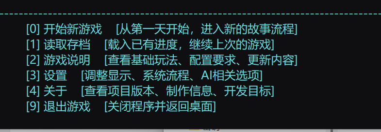

# Era_AI

**当前源码版本：0.3.0** · 创作者：**Natepage**

Era_AI 是基于 Era / Emuera 的 AI 文字冒险项目。框架负责交互、规则结算和进度保存，AI 根据剧本资料、当前情境和玩家输入续写剧情；不同剧本可以拥有各自的世界、人物和玩法。

当前包含「艾拉的奇幻冒险」示例剧本。框架与剧本分开维护，添加剧本不需要修改主菜单或重新构建运行器。

截图用于展示界面风格，可能来自较早版本，以实际运行版本为准。

## 下载与启动

- [历史游戏包：0.2.1 Alpha](https://github.com/MYWnatepage/Era_AI/releases/tag/v0.2.1-alpha)：下载附件 `Era-AI-v0.2.1-alpha-win-x64.zip`，完整解压后运行 `EraAI.exe`。Windows x64 玩家包自带运行环境，无需另外安装 .NET 或 Python。
- **当前0.3.0源码**：需要 Windows x64、.NET 10 SDK 和 PowerShell，在仓库根目录运行 `./构建.ps1`，再启动 `游戏/EraAI.exe`。开发与验证流程见[开发说明](docs/开发说明.md)。

0.2.1是历史发布包，不包含当前0.3.0的全部功能。GitHub自动生成的 `Source code` 压缩包是源码，不是可直接运行的游戏包；其他历史版本以各自的 [Release说明](https://github.com/MYWnatepage/Era_AI/releases)为准。

首次游玩请进入「设置 → 模型连接设置」，填写服务地址和API密钥、读取模型列表并测试连接，详细步骤见[使用说明](使用说明.md)。连接测试和AI生成可能产生费用。

## 主要功能

- **独立剧本与进度**：人物、物品、场景、规则和存档按剧本组织；AI提出的普通状态变化先校验、确认，再成为本局进度。
- **探索与行动**：原生三维地图、自由绘制路线、按距离移动，以及剧本配置的地点行动、骰子、行动点和疲劳规则。
- **对话与记忆**：自由输入、建议行动、历史对话与长期记忆，按当前行动选择发送给AI的相关资料。
- **连接与展示**：网络API、模型及生成参数设置、近7日用量与费用估算、自定义显示和音乐、可调速逐字显示。

本地大模型接入、流式回复和图片生成尚未完成；固定商店、自动找零及更丰富的事件规则仍待扩展，见[开发路线图](docs/ROADMAP.md)。

## 文档入口

| 想了解什么 | 文档 |
| --- | --- |
| 启动、操作、生成设置、费用和常见问题 | [使用说明](使用说明.md) |
| 当前示例剧本的背景与玩法 | [艾拉的奇幻冒险](游戏/ERB/script/艾拉的奇幻冒险/剧本说明.md) |
| 从零制作新剧本 | [剧本制作指南](docs/剧本制作指南.md) |
| 框架结构、接口与维护 | [开发说明](docs/开发说明.md) |
| 剧情显示、逐字播放与骰子动画 | [显示与动画说明](docs/显示与动画说明.md) |
| 版本变化与后续计划 | [更新记录](更新记录.md) · [开发路线图](docs/ROADMAP.md) |
| 参与维护、制作发布包与反馈安全问题 | [贡献说明](CONTRIBUTING.md) · [发布检查清单](docs/RELEASING.md) · [安全反馈](SECURITY.md) |

使用后生成的配置、密钥、存档、对话、用量和日志属于个人数据，请勿直接提交到公开仓库或打包分享。发现问题可通过 [Issues](https://github.com/MYWnatepage/Era_AI/issues/new/choose)反馈，附版本、复现步骤和已遮挡私人信息的截图。

Era_AI 基于 Emuera.NET（EM+EE）修改。感谢上游运行器及依赖作者；运行器、第三方素材和新增内容的许可范围见 [LICENSE.md](LICENSE.md)，原有版权与署名应随源码和发布包保留。
