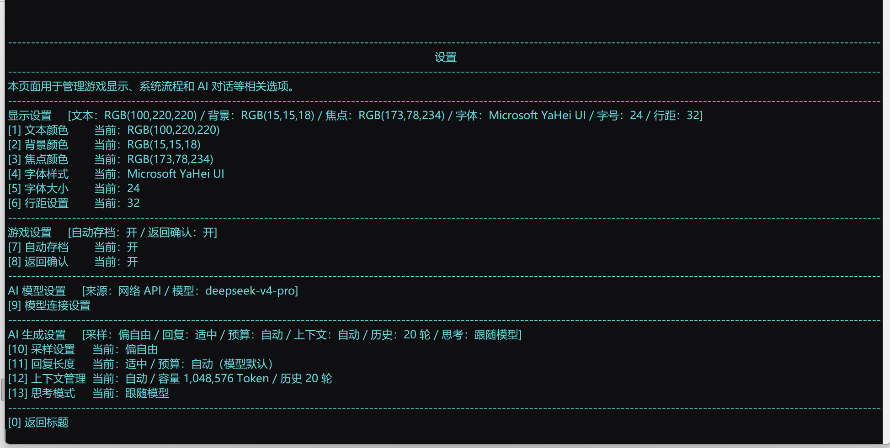

# Era_AI

**当前项目版本：0.3.0**

> 0.3.0 已在本地项目中完成版本更新，详见[更新记录](更新记录.md)。下方下载链接保留对应历史发布包；发布包的内容以其 Release 说明为准，不代表已包含本地0.3.0的全部功能。

[](https://github.com/MYWnatepage/Era_AI/actions/workflows/ci.yml)

[历史发布下载](https://github.com/MYWnatepage/Era_AI/releases/tag/v0.2.1-alpha) · [使用说明](使用说明.md) · [常见问题](docs/FAQ.md) · [反馈问题](https://github.com/MYWnatepage/Era_AI/issues/new/choose) · [开发路线](docs/ROADMAP.md) · [更新日志](CHANGELOG.md)

一个基于 Era / Emuera 的 AI 文字冒险项目。

Era_AI 希望把传统 Era 游戏的规则与进度管理，同 AI 对话的变化性结合起来：由剧本管理人物状态、物品与事件结果，让 AI 负责更自然的对话和场景表达。

当前项目提供「艾拉的奇幻冒险」示例剧本，支持自由输入、人物与物品管理、原生三维地图及路线移动、骰子判定、行动点与疲劳、长期记忆及存读档。框架同时提供模型连接、生成设置、用量记录和可调速的剧情显示，具体世界和玩法由剧本配置。


<details>
<summary>查看设置界面示例</summary>



截图用于展示界面风格，可能来自较早版本；设置值仅为示例，以实际运行版本为准。

</details>

## 下载与启动

前往 [Releases](https://github.com/MYWnatepage/Era_AI/releases) 下载游戏。

历史发布包：[Era_AI 0.2.1 Alpha](https://github.com/MYWnatepage/Era_AI/releases/tag/v0.2.1-alpha)。当前本地项目版本为0.3.0。

| 版本 | 用途 |
| --- | --- |
| [0.2.1 Alpha](https://github.com/MYWnatepage/Era_AI/releases/tag/v0.2.1-alpha) | 保留的历史发布，运行包与对应源码提交一致 |
| [0.2.0 Alpha](https://github.com/MYWnatepage/Era_AI/releases/tag/v0.2.0-alpha) | 保留的前一发布；其自动源码下载与运行包不对应，详见发布页更正 |
| [测试版本V 1.0 历史清理版](https://github.com/MYWnatepage/Era_AI/releases/tag/legacy-v1.0-test) | 早期 Python Bridge 版本，仅作历史留存 |

1. 下载附件 **`Era-AI-v0.2.1-alpha-win-x64.zip`**。
2. 完整解压到有写入权限的文件夹，不要在压缩包内直接运行。
3. 双击 **`EraAI.exe`** 启动。

发布包适用于 **Windows x64**，自带 .NET 运行环境，无需另外安装 .NET 或 Python。联网 AI 对话需要自行准备服务商提供的 API 密钥。

> 请下载 Release 附件中的游戏压缩包。GitHub 自动生成的 `Source code` 压缩包不是可直接运行的游戏包。当前项目说明以0.3.0为准，历史发布包请查阅对应版本说明。

## 首次连接 AI

进入 **「设置 → 模型连接设置」**，按以下顺序配置：

1. **接入方式**：选择「网络 API」。本地大模型入口暂未完成。
2. **服务地址**：选择平台预设，或填写兼容 Chat Completions 的 API 根地址。
3. **API 密钥**：填入该服务商提供的完整密钥。
4. **选择模型**：读取服务返回的模型列表，再选择需要使用的模型。
5. **测试当前连接**：确认配置能否正常生成回复。

服务地址提供 DeepSeek、Gemini、Grok 和 GPT / OpenAI 的预设。预设用于填写地址；可用模型、支持的参数及访问条件由对应服务决定。

配置修改后自动保存。连接测试会发送生成请求，可能产生 Token 消耗；正常游玩中的 AI 回复也会产生相应消耗。

## 当前开发功能（含未发布改动）

### 剧本与进度

- 框架按剧本登记自动发现与调用；人物、行动及生存规则由剧本维护，存档按剧本编号分目录。新增剧本无需修改框架或重新构建，详见[剧本接入](docs/剧本接入.md)。
- 「艾拉的奇幻冒险」独立剧本，作者维护初始人物卡、物品卡，并在剧本.json中统一维护剧本背景、开场与规则。
- 自由输入、建议行动、每天一次 D20 狩猎和休息；时间用 8 个实心/空心方格显示，每天消耗 2 份食材。
- 当前物品表保存数量、描述和归属，新增物品自动分配数字编号。
- AI 返回剧情及物品提案；没有确定玩法规则的物品变化需先预览确认，取消不更新库存、时间或记忆。程序控制的狩猎和每日消耗自动结算。
- 存档恢复物品、日期、狩猎状态与对话历史，新游戏从空历史开始；旧档按规则迁移。
- 同一游戏目录只允许一个窗口运行，独立副本可分别运行，避免存档和活动记忆相互覆盖。
- [剧本玩家说明](游戏/ERB/script/艾拉的奇幻冒险/剧本说明.md)与[作者维护说明](游戏/ERB/script/艾拉的奇幻冒险/说明.md)。

### 模型与生成设置

- 在游戏内配置网络 API、读取模型列表、选择模型和测试连接。
- API 密钥加密保存，支持等待超时设置。
- **采样设置**：均衡、偏稳定、偏自由及自定义，可调整 Temperature、Top P、重复抑制和话题扩展。
- **回复长度**：简短、适中、详细；生成 Token 预算可选择自动或手动设置。
- **上下文管理**：设置历史轮数和上下文预算，查看、刷新服务提供的模型容量信息。
- **思考模式**：按当前模型能力选择跟随模型、关闭优先或不同思考档位。

回复长度是表达目标，Token 预算是输出上限，两者分别设置。不同模型对参数的支持不同，界面中的设置不保证在所有模型上都有效。

### 用量与花费

网络 API 模式下提供账户与消耗信息：

- 已适配服务的账户余额查询，目前支持 DeepSeek 官方接口。
- 本游戏内的今日输入、输出 Token 记录及花费估算。
- 近七日消耗折线图。

今日统计按北京时间累计，包含连接测试，只统计本游戏收到的用量信息。取消或异常请求可能未计入，其他应用的调用也不在本游戏统计范围内；实际费用以服务商账单为准。

### 显示与操作

- 自定义文字、背景和焦点颜色，提供配色与可读性保护。
- 调整字体、字号和行高。
- 支持鼠标点击、菜单编号输入及 Esc 返回。
- 统一菜单列对齐、分组摘要和参数说明。

## 数据与隐私

发布包不包含开发者的 API 密钥、个人配置、存档、对话历史或用量记录。首次使用时需要填写自己的连接信息。

API 密钥使用 Windows DPAPI 加密保存，换电脑或 Windows 账户后需要重新填写。加密不代表可以公开分享配置文件。

使用网络 API 时，当前输入、角色说明和选入的历史会发送给所选服务商。请根据自己的需要选择服务，并留意对话内容。

使用后生成的以下内容属于玩家自己的数据，请勿直接提交到公开仓库或重新打包分享：

- `配置/`：连接信息、密钥及个人设置。
- `数据/`：对话历史、用量等运行数据。
- 存档、日志及其他个人运行配置。

分享游戏时请使用清理后的发布包，不要直接压缩自己已经游玩过的文件夹。

## 已知限制

- 当前版本为0.3.0，后续更新仍会继续完善功能与存档兼容。
- 场景移动和动态人物登记已接通；固定商店、自动找零及更丰富的事件规则仍待扩展。
- 本地大模型接入与流式输出尚未完成；原生地图和骰子动画已接入。
- 上下文裁剪使用估算，不能替代模型自身的精确分词。
- 部分服务不提供模型容量信息；未获取到容量不代表模型无法使用。
- 自动预算沿用服务或模型的默认行为，不保证低消耗。
- 没有完整历史快照的旧存档，只能恢复存档自身保存的短期对话。

升级前请保存好自己的进度与配置。发现问题时，欢迎通过 [Issues](https://github.com/MYWnatepage/Era_AI/issues) 反馈，附上复现步骤、版本号和截图；请遮挡密钥及私人对话。

## 后续方向

- 继续完善本局人物、场景、NPC与事件的联动，让变化与叙事保持一致。
- 为交易、装备使用及其他行动建立明确规则，逐步减少需要人工确认的物品提案。
- 优化重要经历摘要和长期记忆的按需召回，支持长流程。
- 继续做连续试玩与兼容测试；本地模型和流式输出作为后续扩展。

以上为开发方向，不代表当前版本已经具备，也不承诺具体完成时间。

## 作者与致谢

创作者：**Natepage**。

Era_AI 基于 **Emuera.NET（EM+EE）** 修改。感谢 Emuera 及相关上游项目、依赖库的作者。

运行器与各依赖的版权、许可归各自作者所有，相关原文随发布包保留在 `许可/` 文件夹中。 新增原创内容尚未选定统一的独立开源许可证，具体范围见 [LICENSE.md](LICENSE.md)。

## 从源码构建

开发环境需要 Windows x64、.NET 10 SDK 和 PowerShell。

```powershell
./构建.ps1
./测试.ps1
```

构建完成后运行 `游戏/EraAI.exe`。核心测试使用模拟响应，不需要 API 密钥，也不会调用真实模型。

安装 Python 3 后，执行 `./测试.ps1 -Scenario` 可运行核心与重点剧本测试；`./测试.ps1 -Engine` 运行全部引擎集成测试。测试在临时目录中使用独立游戏副本，不读取个人配置与存档。

仓库中的 `源码/` 保存修改后的运行器与上游许可，`游戏/CSV` 和 `游戏/ERB` 保存游戏数据与剧本，`测试/` 保存核心和引擎回归测试。可执行文件及自带运行环境的玩家包通过 Releases 提供。

## 仓库维护

工作流配置为提交与 Pull Request 运行 Windows x64 构建、核心模拟测试和重点剧本集成测试，不使用真实 API 密钥。全部界面测试和发布包检查仍需另外执行；本地修改的工作流需提交到仓库后才会在 GitHub 生效。

- [贡献与提交流程](CONTRIBUTING.md)
- [发布检查清单](docs/RELEASING.md)
- [安全与隐私反馈](SECURITY.md)
- [任务列表](https://github.com/MYWnatepage/Era_AI/issues) 与 [里程碑](https://github.com/MYWnatepage/Era_AI/milestones)
